# Design system — Historiales clínicos

> Estado: **aprobado el 2026-11-05** (OpenSpec `fase-1-design-system`, archivado en `openspec/specs/design-system`).
> Código: [`apps/web/src/styles.css`](../../apps/web/src/styles.css) (tokens + componentes) ·
> [`apps/web/src/ui.tsx`](../../apps/web/src/ui.tsx) (primitivas) ·
> [`apps/web/src/Grafica.tsx`](../../apps/web/src/Grafica.tsx)

## Principios

1. **Blanco primero.** La superficie es blanca; la jerarquía sale del peso tipográfico y el espacio, no del color.
2. **Una sola acción primaria por región**, en tinta (`#18181b`) sobre blanco.
3. **Un solo acento** (teal) para foco, selección y gráficas. Nada más es teal.
4. **El color significa algo.** Verde/ámbar/rojo/azul solo para estado; ámbar y azul también para la clasificación de datos (§8 de AGENTS.md), siempre con ícono + texto.
5. **La misma pantalla para las cuatro instituciones.** El motor es una etiqueta, no un tema.
6. **Accesible por defecto:** contraste AA, foco visible, teclado completo, `prefers-reduced-motion`.

## Tokens

### Color

| Token | Valor | Uso |
|---|---|---|
| `--surface` | `#ffffff` | Fondo de app, tarjetas, diálogos |
| `--surface-subtle` | `#fafafa` | Censo lateral, cabecera de tablas, pie de diálogo |
| `--surface-muted` | `#f4f4f5` | Hover, segmented, avatar, skeleton |
| `--border` / `--border-strong` | `#e4e4e7` / `#d4d4d8` | Divisores / bordes de inputs |
| `--text` / `--text-secondary` / `--text-muted` | `#18181b` / `#52525b` / `#71717a` | Texto principal / secundario / metadatos |
| `--primary` | `#18181b` | Botón primario, pestaña activa, chip activo, toast |
| `--accent` | `#0f766e` | Anillo de foco, enlaces (5.4:1 sobre blanco) |
| `--chart-1` | `#0d9488` | Serie de gráficas (validada: luminosidad, croma, contraste) |
| `--success` · `--warning` · `--danger` · `--info` | `#15803d` · `#b45309` · `#b91c1c` · `#1d4ed8` | Estado; cada uno con `-soft` (fondo) y `-border` |
| `--clasif-confidencial` | = `--info` | DPI, nombre, teléfono, dirección |
| `--clasif-restringido` | = `--warning` | Diagnósticos, laboratorio, datos de menores |

### Tipografía

Inter 400/500/600 · cuerpo **14px** · cifras tabulares en datos.

| Token | px | Uso |
|---|---|---|
| `--text-xs` | 12 | Metadatos, insignias, pistas |
| `--text-sm` | 13 | Texto secundario, etiquetas de campo |
| `--text-base` | 14 | Cuerpo |
| `--text-md` | 16 | h3, títulos de tarjeta |
| `--text-lg` | 18 | Título de diálogo |
| `--text-xl` | 22 | Nombre del paciente |
| `--text-2xl` | 28 | Indicadores, título de ingreso |

### Espacio, forma, profundidad

- Escala de 4px: `--space-1…12` = 4, 8, 12, 16, 20, 24, 32, 40, 48.
- Radios: 6 (controles pequeños), 8 (botones, inputs), 12 (tarjetas, diálogos), 999 (insignias, chips).
- Sombras: `xs` en controles, `md` en tooltips, `lg` solo en diálogos y toasts. Las tarjetas usan borde, no sombra.
- Alto de control: 36px; 44px en la acción principal del ingreso.

## Componentes

| Componente | Variantes | Cuándo |
|---|---|---|
| `Boton` | `primary` · `secondary` · `ghost` · `danger`; `sm`/`md`/`lg`; con ícono; `cargando` | `primary`: la acción principal de la región. `ghost`: acciones de fila. `danger`: solo dentro de un diálogo de confirmación |
| `Campo` | etiqueta, `(opcional)`, pista, error | Todo input. El error reemplaza la pista y se enlaza con `aria-describedby` |
| `Insignia` | neutral · success · warning · danger · info · accent; con punto o ícono | Estado de cita, examen, expediente |
| `EtiquetaClasificacion` | público · confidencial · restringido | Encabezado de toda sección con datos sensibles |
| `Alerta` | info · success · warning · danger | Error de guardado, solo lectura, dosis vencidas |
| `Dialogo` | normal (520px) · pequeño (420px) | Todo formulario de registro y toda confirmación destructiva |
| Toast (`useToast`) | — | Confirmación de una escritura exitosa (3.5 s) |
| `Vacio` | ícono + título + texto + acción | Lista sin datos |
| `Esqueleto` | — | Carga del censo |
| `DatoProtegido` | — | DPI enmascarado con botón mostrar/ocultar |
| `Avatar` | 32 · 48 | Iniciales del paciente o del usuario |
| Pestañas | con conteo | Secciones del expediente (flechas, Home, End) |
| Tabla | — | Agenda, vacunas, tabla de crecimiento |
| `Grafica` | serie única | Peso y talla; nunca doble eje; con «Ver tabla» |

## Patrones

- **Registrar algo** → botón `primary` «+ Nueva …» arriba a la derecha de la sección → diálogo → toast.
- **Acción sobre un elemento** (validar examen, cancelar cita) → botón `ghost`/`sm` en la fila o el pie de la tarjeta.
- **Destructivo/irreversible** (archivar) → botón `secondary` → diálogo pequeño con motivo → botón `danger`.
- **Error** → `Alerta` danger arriba del contenido, descartable, con mensaje en lenguaje del médico (no del motor).
- **Archivado** → `Alerta` info «Expediente archivado» + ninguna acción de registro.

## Do / Don't

| Do | Don't |
|---|---|
| Un `primary` por región | Dos botones negros lado a lado |
| Estado con insignia + texto | Estado solo con color |
| Formularios en diálogo | Formularios siempre visibles bajo la lista |
| Fechas por defecto relativas a hoy | Fechas fijas en el código |
| Una gráfica por medida | Peso y talla en el mismo eje |
| Mensajes de dominio («Ese horario se cruza con otra cita») | Mensajes del motor («duplicate key value violates…») |

## Capturas

| | |
|---|---|
| 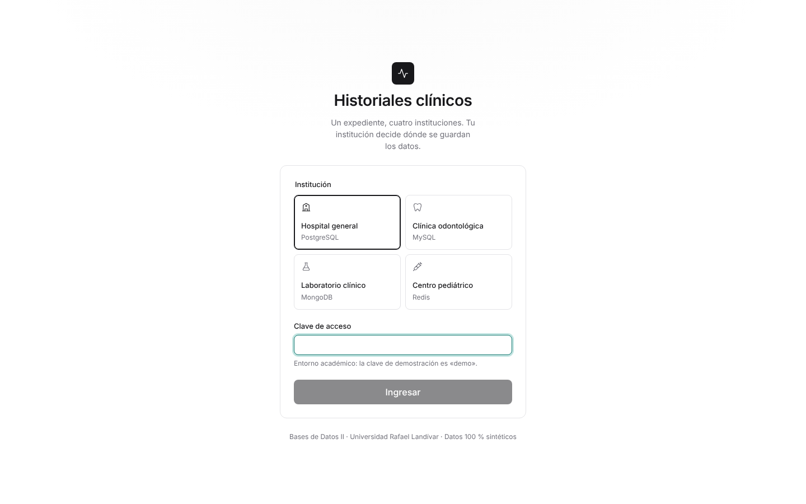 | 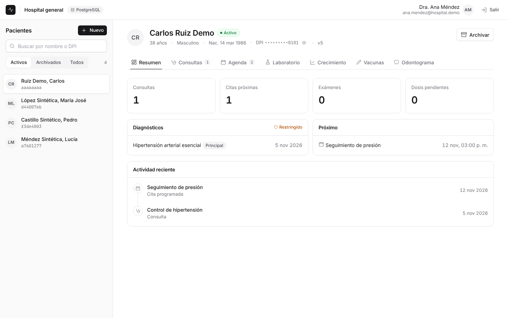 |
| 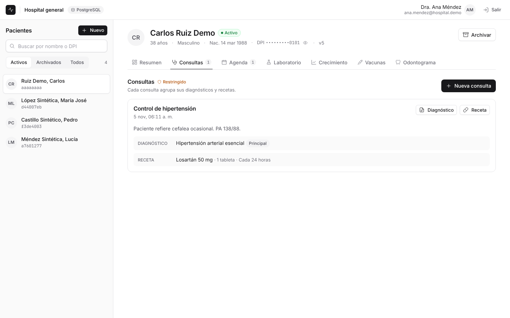 | 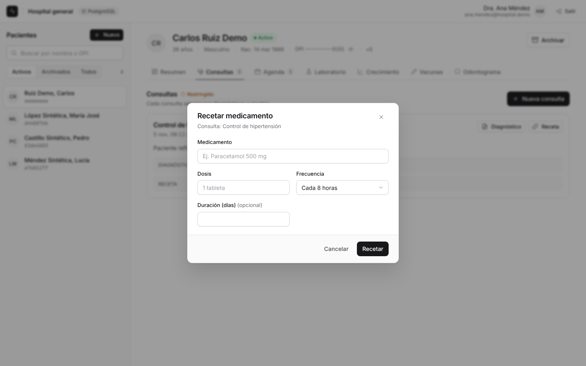 |
| 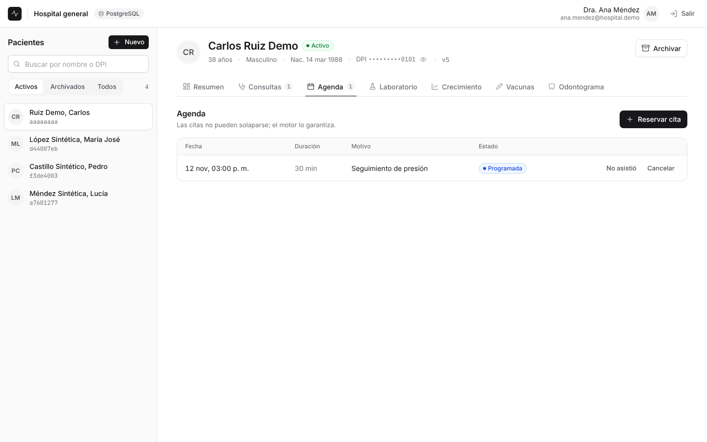 | 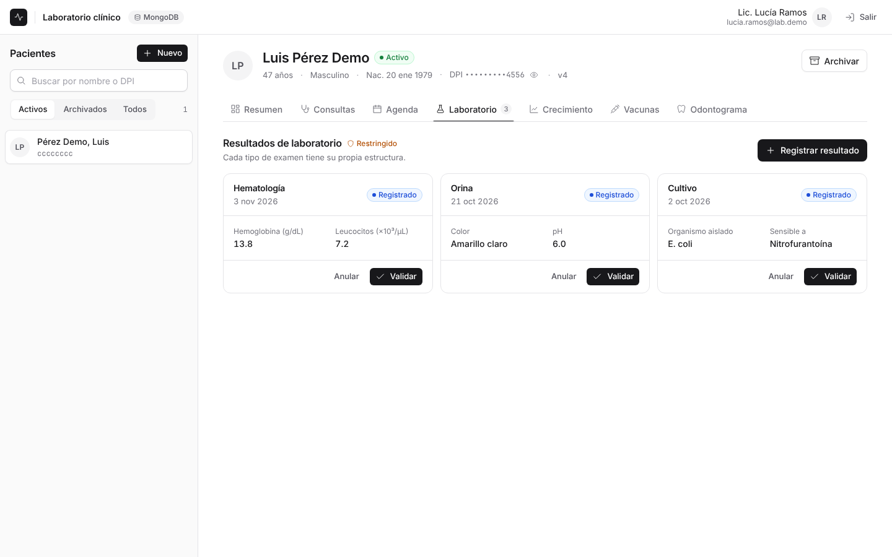 |
| 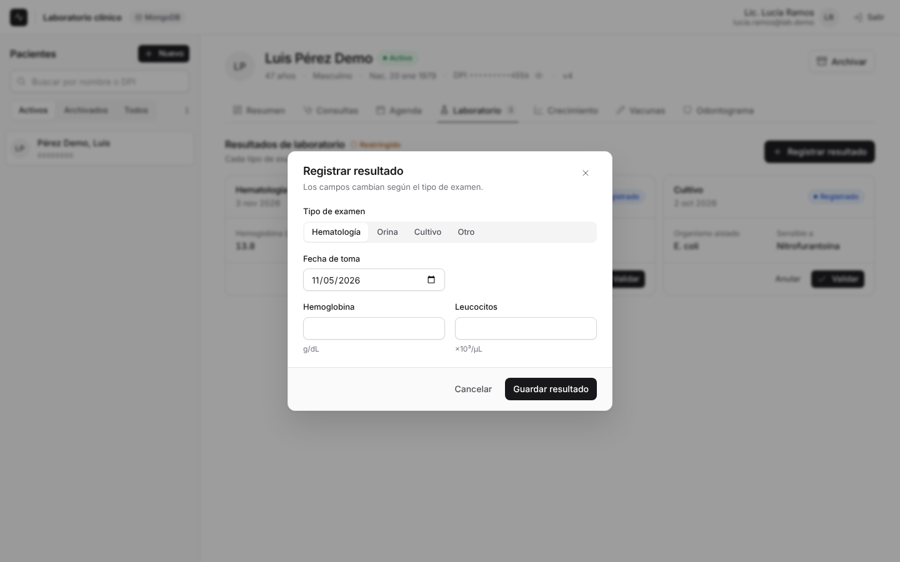 | 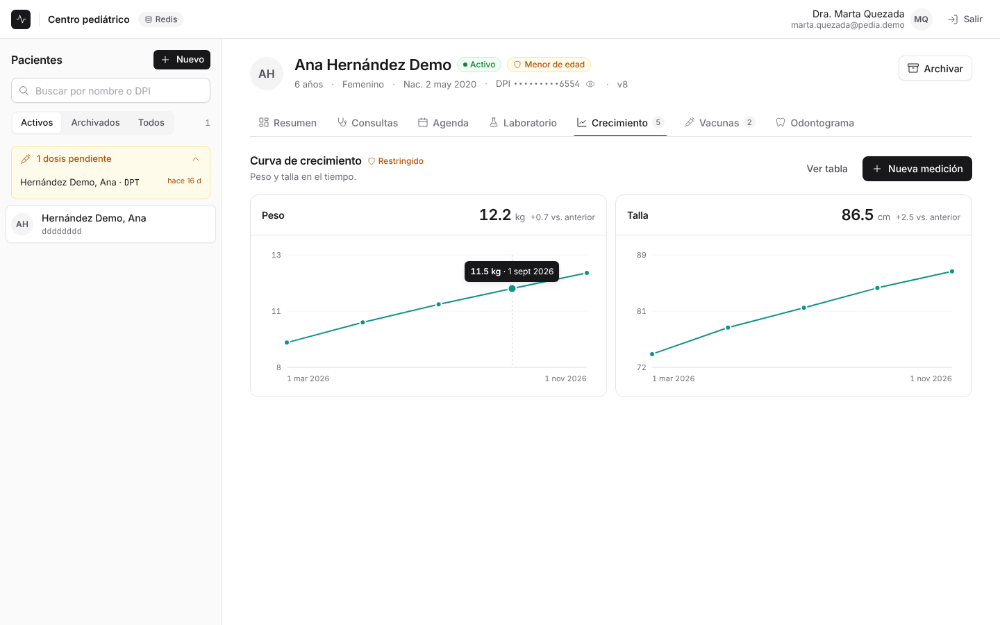 |
| 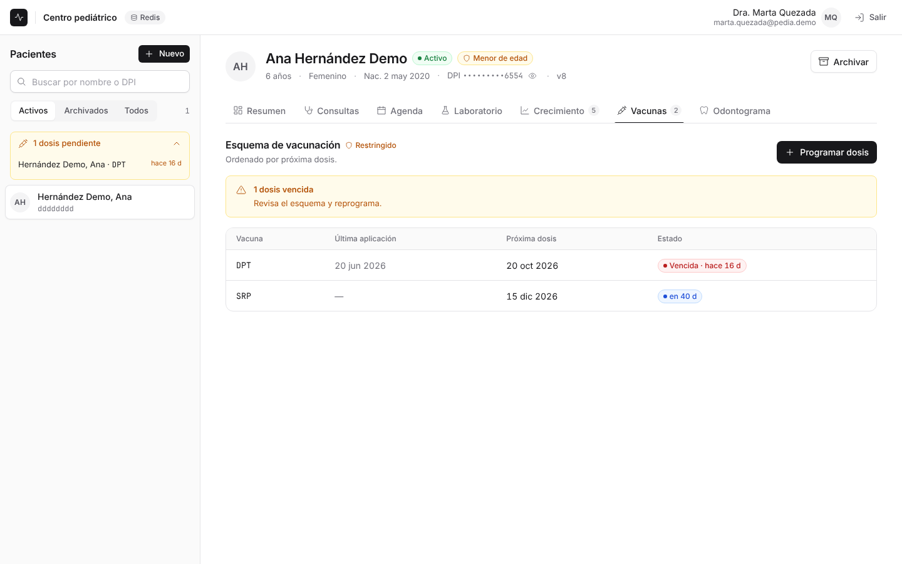 | 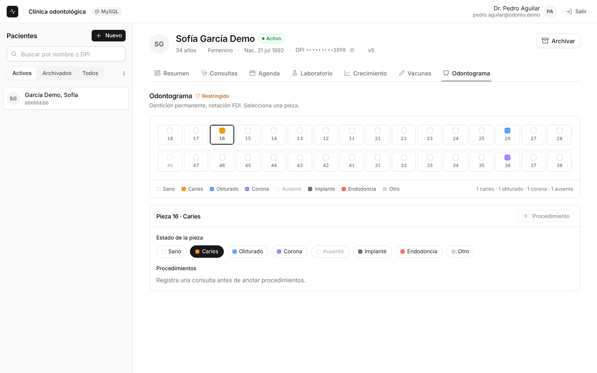 |
| 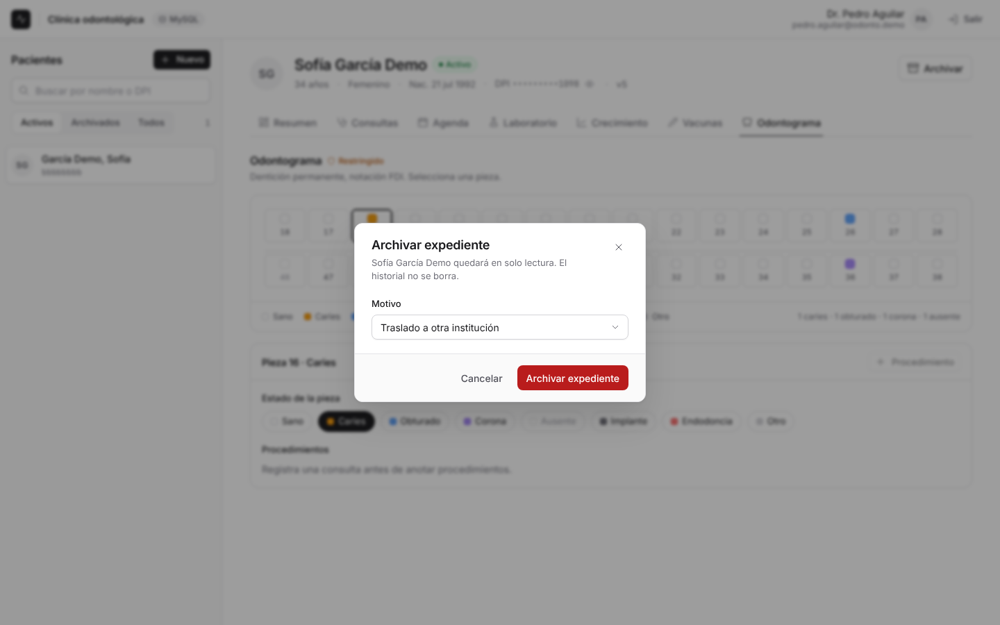 | 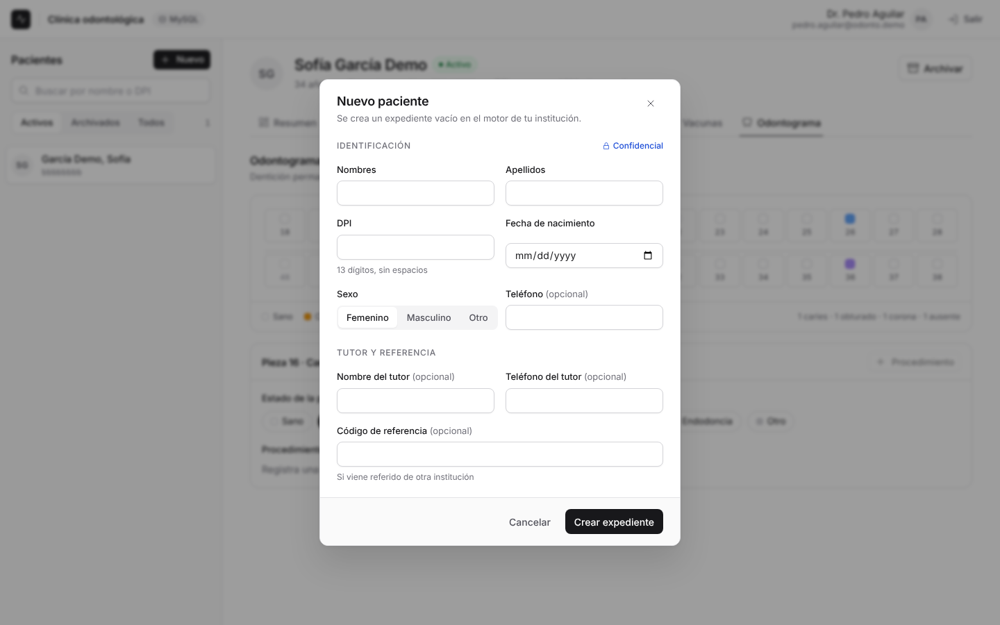 |

Móvil (390px): 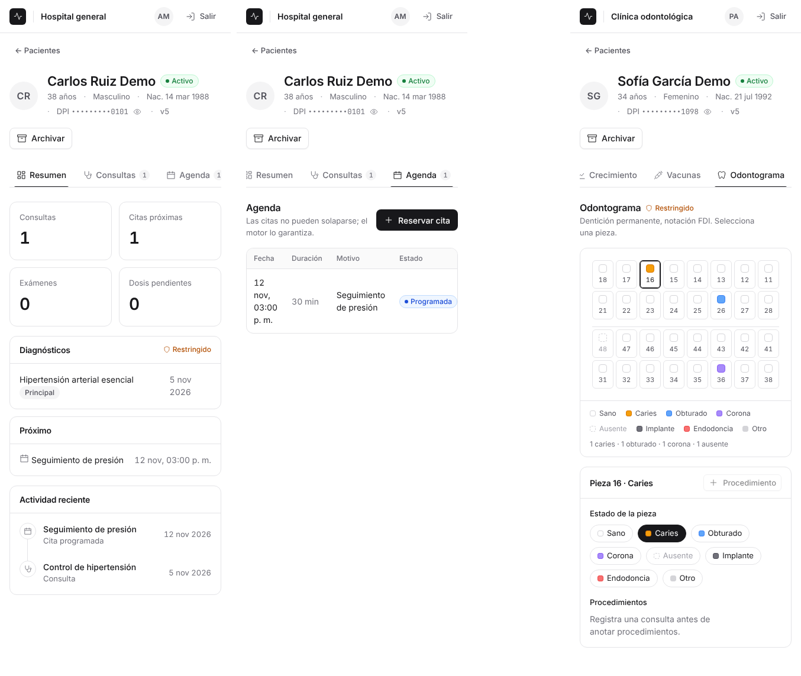
