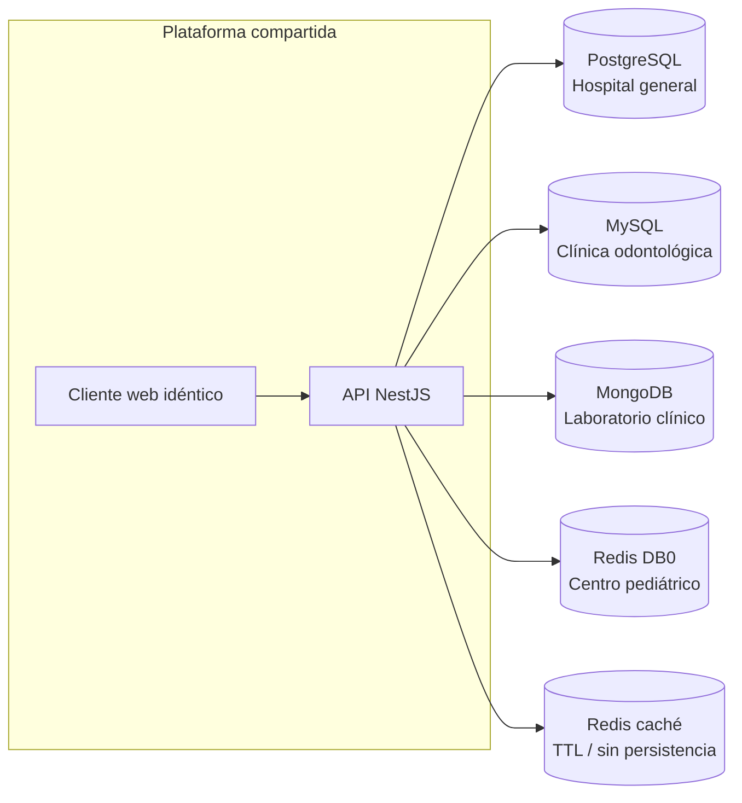

# Contexto: red de instituciones y motores

| Institución | Motor | Entrega I |
|---|---|---|
| Hospital general | PostgreSQL | ER + DDL 3NF |
| Clínica odontológica | MySQL | ER + DDL 3NF + odontograma |
| Laboratorio clínico | MongoDB | Análisis completo (entidades, atributos, ops) |
| Centro pediátrico | Redis | Análisis completo (entidades, atributos, ops) |

Cada institución es dueña de su infraestructura. Un mismo motor no se repite.
