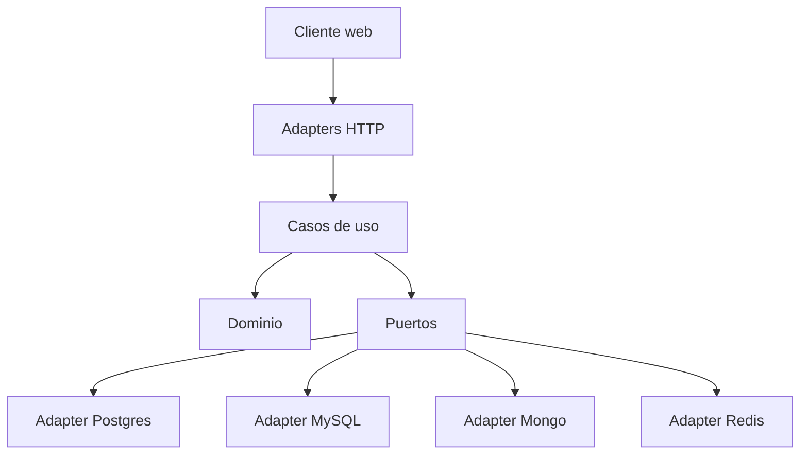

# Arquitectura hexagonal (contexto, no se evalúa)

Regla: `dominio/` no importa NestJS ni drivers. Los casos de uso no tienen `if` por motor. El JWT (Entrega II) lleva `institucionId` y un provider de request scope elige el adaptador.
