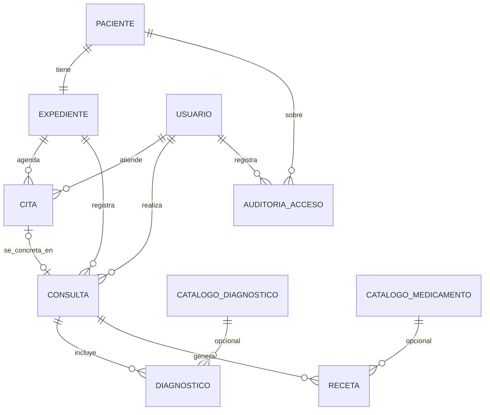

# Dominio conceptual — núcleo compartido

Levantamiento común a las cuatro instituciones. Las extensiones (odontograma, resultado de examen, curva/vacunas) se documentan en cada institución.

Cardinalidades:

| Relación | Tipo |
|---|---|
| Paciente–Expediente | 1:1 (por institución / motor) |
| Expediente–Cita | 1:N |
| Expediente–Consulta | 1:N |
| Cita–Consulta | 0..1 : 0..1 (conectadas; una cita puede no concretarse) |
| Consulta–Diagnóstico | 1:N |
| Consulta–Receta | 1:N |

Extensiones (documentadas en sus secciones):

- Odontología: Expediente 1:N PiezaDental; Pieza 1:N ProcedimientoDental
- Laboratorio: Expediente 1:N ResultadoExamen (referenciado; forma según TipoExamen)
- Pediatría: Expediente 1:N MedicionCrecimiento; Expediente 1:N DosisVacuna

