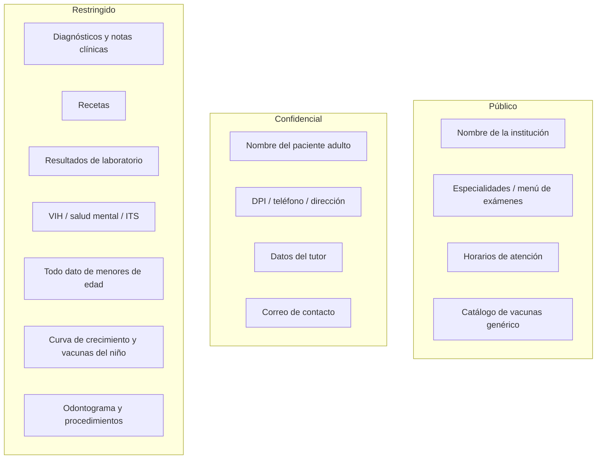

# Clasificación de información

Tres niveles, aplicables a las **cuatro** instituciones.

## Matriz por institución

| Dato / institución | Hospital | Odontología | Laboratorio | Pediátrico |
|---|---|---|---|---|
| Nombre institución, horarios | Público | Público | Público | Público |
| Identidad paciente adulto | Confidencial | Confidencial | Confidencial | — |
| Identidad menor + tutor | — | — | — | Restringido / Confidencial (tutor) |
| Diagnóstico / notas / receta | Restringido | Restringido | Secundario | Restringido |
| Resultado de examen | — | — | Restringido | — |
| Odontograma | — | Restringido | — | — |
| Crecimiento / vacunas | — | — | — | Restringido |

## Reglas transversales

1. Ningún dato **restringido** en logs de aplicación — ni en desarrollo.
2. Todo acceso a restringido genera entrada de auditoría (quién, qué, cuándo).
3. Usuarios de BD con privilegios mínimos (`hospital_app`, `odontologia_app`; equivalentes en Mongo/Redis en Entrega II).
4. Seeds **sintéticos** únicamente. Jamás datos clínicos reales.
5. En pediatría el expediente completo del menor se trata como restringido por edad.

## Sensibilidad alta (subconjunto de restringido)

Marcar en catálogo o metadatos cuando aplique: VIH, salud mental, ITS, genética. El acceso debe auditarse igual; la UI futura puede exigir confirmación adicional (fuera del alcance de Entrega I).
