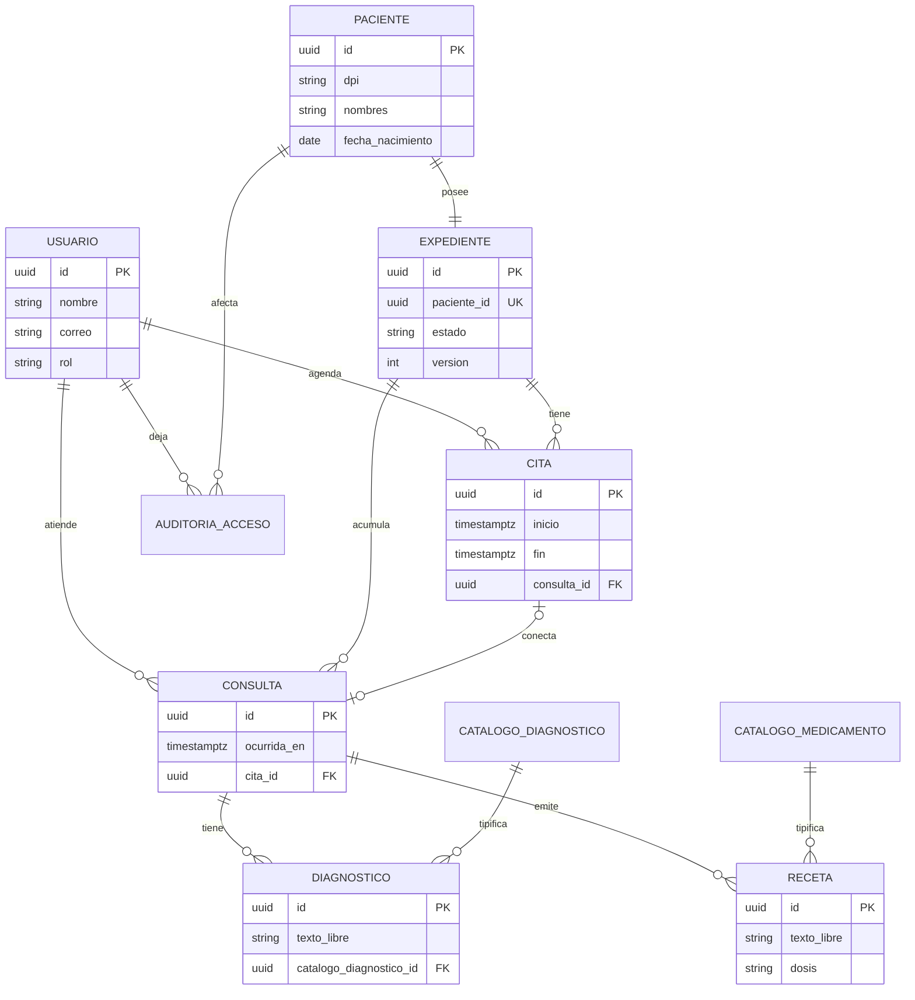

# Hospital general — PostgreSQL

## Modelo entidad-relación

## Modelo relacional (físico Entrega I)

Schema `clinico` en la base `hospital`:

- `usuario`, `paciente`, `expediente`
- `cita`, `consulta` (FK cruzadas opcionales)
- `catalogo_diagnostico`, `catalogo_medicamento`
- `diagnostico`, `receta`
- `auditoria_acceso`

DDL: `apps/api/src/infraestructura/postgres/migrations/001_clinico.sql`

## Decisión diferida: Event Sourcing

En Entrega II el Hospital migrará a event store + read model (el expediente se **enmienda**, no se UPDATE). Entrega I entrega el historial en 3NF para cumplir el enunciado de modelo relacional normalizado.
