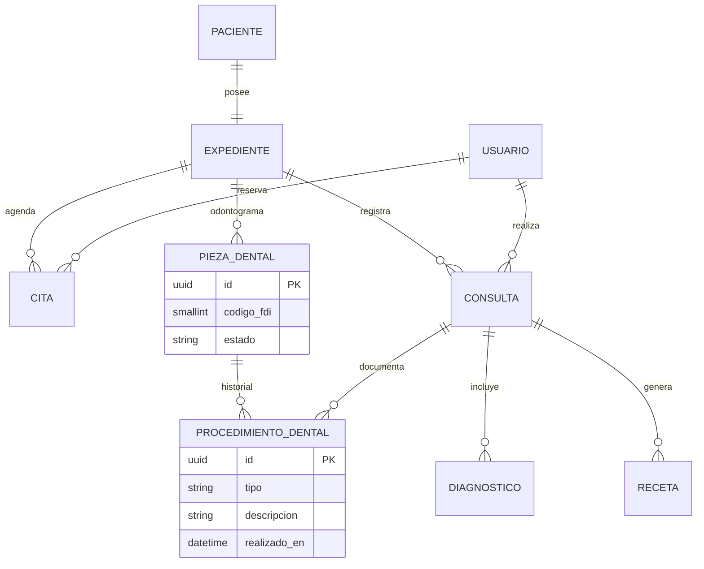

# Clínica odontológica — MySQL

## Modelo entidad-relación

## Odontograma

32 filas por expediente (códigos FDI 11–48). **Descartado:** JSON (rompe 1NF en un entregable de normalización) y 32 columnas (sin historial).

Cada intervención queda en `procedimiento_dental` ligada a la pieza y a la consulta.

## Modelo relacional

Tablas InnoDB `utf8mb4` en base `odontologia`. Sin Event Sourcing: simplicidad deliberada (hallazgo comparativo).

DDL: `apps/api/src/infraestructura/mysql/migrations/001_clinico.sql`

## Solapamiento de citas

MySQL no tiene exclusion constraint como PostgreSQL `btree_gist`. En Entrega II el equivalente operativo es `SELECT … FOR UPDATE` dentro de transacción `REPEATABLE READ`. Documentado; no se finge una constraint de tabla.
