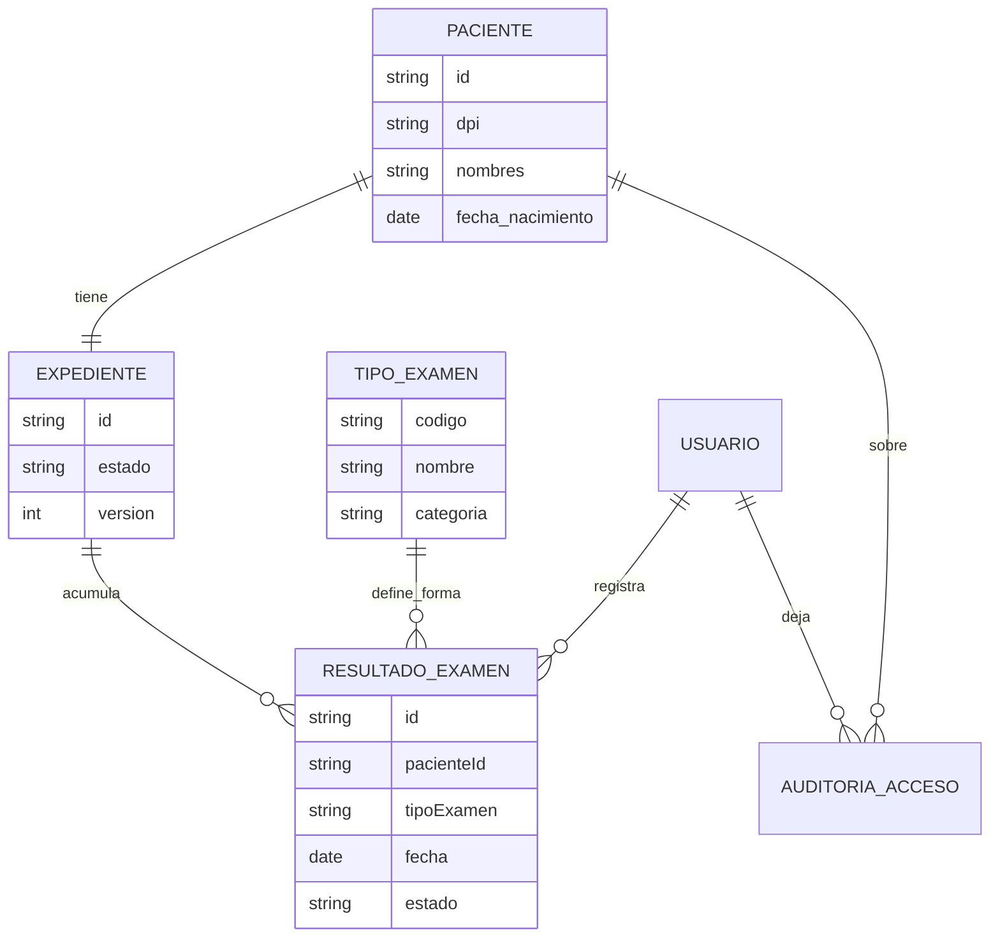
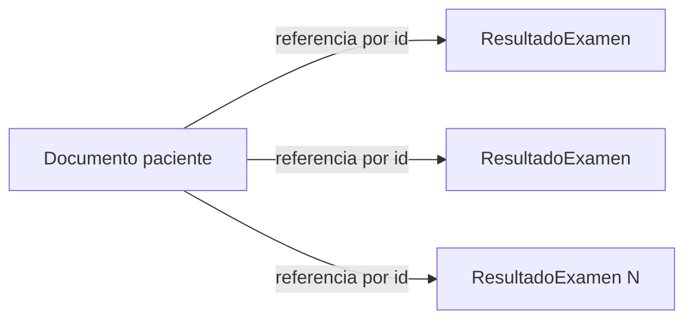

# Laboratorio clínico — análisis de información (MongoDB)

El laboratorio **no** se modela en tablas relacionales en esta entrega (evitar EAV). Sí se levanta el mismo rigor de entidades, atributos, clasificación y operaciones que Hospital y Odontología, porque el enunciado exige cubrir las cuatro instituciones.

Motor asignado (decisión de proyecto): **MongoDB**. La implementación documental completa es Entrega II; aquí queda el análisis listo para esa implementación.

## Por qué no es relacional

Una hematología, un examen de orina y un cultivo tienen **estructuras distintas**. Forzarlas a un esquema SQL fijo lleva a:

- columnas nullable por tipo de examen, o
- EAV (`examen_id`, `campo`, `valor`) — la anti-solución: sin tipado, consultas lentas, validación imposible.

MongoDB encaja porque el resultado es un documento cuya forma depende del `tipoExamen`, con validación por schema (sin esquema ≠ sin validación).

## Modelo conceptual

## Relación con el núcleo compartido

| Núcleo | En laboratorio |
|---|---|
| Paciente, Expediente, Usuario, Auditoría | Igual significado |
| Consulta / Diagnóstico / Receta | Opcionales o secundarios: el flujo principal es el **resultado de examen** |
| Cita | Puede existir para toma de muestra; no es el núcleo del valor clínico |

## Entidades y atributos

### Paciente / Expediente / Usuario / AuditoriaAcceso

Mismos atributos lógicos del núcleo (ver documento de entidades). En laboratorio el paciente puede no tener DPI si es referido con código externo — atributo opcional `codigo_referencia`.

### TipoExamen (catálogo)

| Atributo | Tipo lógico | Clasificación | Notas |
|---|---|---|---|
| codigo | texto | público | ej. `HEM_COMP`, `ORO_GRAL`, `CUL_URI` |
| nombre | texto | público | |
| categoria | enum | público | hematologia / orina / cultivo / otro |
| descripcion | texto | público | |
| campos_esperados | lista de nombres | público | guía de validación; no son valores clínicos |

### ResultadoExamen

| Atributo | Tipo lógico | Clasificación | Notas |
|---|---|---|---|
| id | identificador | — | |
| pacienteId | referencia | — | **no** embeber el paciente |
| expedienteId | referencia | — | |
| tipoExamen | texto / ref | público | determina la forma de `valores` |
| fecha | timestamp | confidencial | fecha de toma / reporte |
| estado | enum | confidencial | pendiente / validado / anulado |
| solicitanteId | ref usuario | confidencial | médico que pidió |
| validadorId | ref usuario | confidencial | laboratorista |
| valores | estructura variable | **restringido** | ver abajo |
| observaciones | texto | restringido | |
| version | entero | — | concurrencia optimista |

### Forma de `valores` según tipo (ejemplos sintéticos)

**Hematología completa**

| Campo | Tipo |
|---|---|
| eritrocitos | número |
| hemoglobina | número |
| hematocrito | número |
| leucocitos | número |
| plaquetas | número |
| unidades | texto |

**Orina general**

| Campo | Tipo |
|---|---|
| color | texto |
| aspecto | texto |
| densidad | número |
| ph | número |
| proteinas | texto / enum |
| glucosa | texto / enum |

**Cultivo**

| Campo | Tipo |
|---|---|
| muestra | texto |
| microorganismo | texto |
| sensible_a | lista de textos |
| resistente_a | lista de textos |
| tiempo_incubacion_h | entero |

## Embeber vs referenciar (decisión de modelado documental)

**Decisión:** exámenes **referenciados**, no embebidos dentro del paciente.

Razones:

1. Un paciente acumula cientos de exámenes a lo largo del tiempo.
2. Embeber choca con el límite práctico de 16 MB por documento BSON.
3. Casi nunca se necesitan “todos los exámenes + ficha” en la misma lectura.

**Descartado:** un solo documento paciente con arreglo `examenes[]` embebido.

## Índices y consistencia (anticipación Entrega II)

- Índice mínimo: `{ pacienteId: 1, fecha: -1 }`.
- Concurrencia: `replaceOne` filtrando por `id` + `version`.
- Transacciones multi-documento requieren replica set (ya previsto en Compose).

## Clasificación específica

| Dato | Nivel |
|---|---|
| Nombre del laboratorio, menú de exámenes | Público |
| Identidad del paciente, fecha de toma | Confidencial |
| Todos los `valores`, cultivos, marcadores sensibles | Restringido |
| Resultados asociados a VIH / ITS / genética | Restringido (sensibilidad alta) |

## Operaciones propias del laboratorio

1. Registrar solicitud / resultado de examen (estructura según tipo).
2. Validar o anular un resultado.
3. Consultar historial de exámenes de un paciente (paginado por fecha).
4. Abrir un resultado concreto (dispara auditoría).
5. Archivar expediente del paciente referido.
