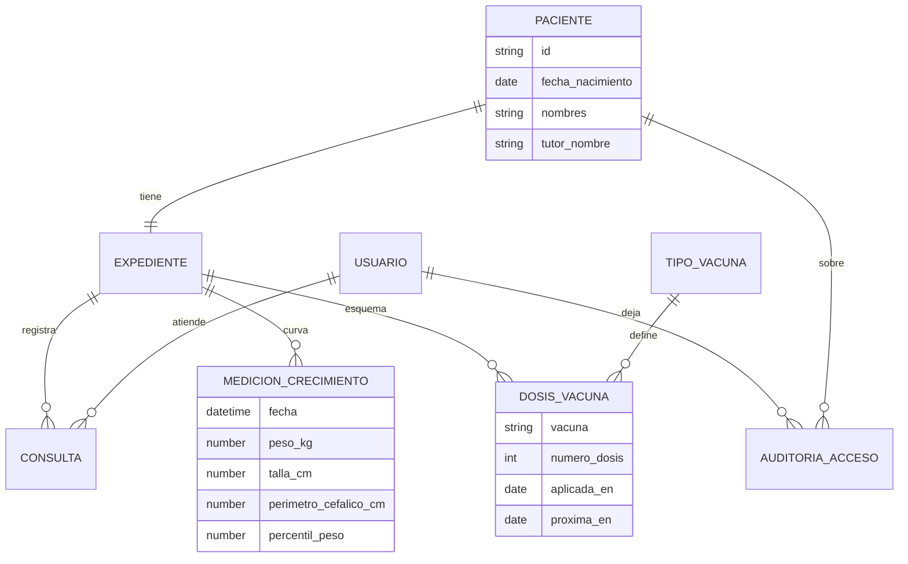
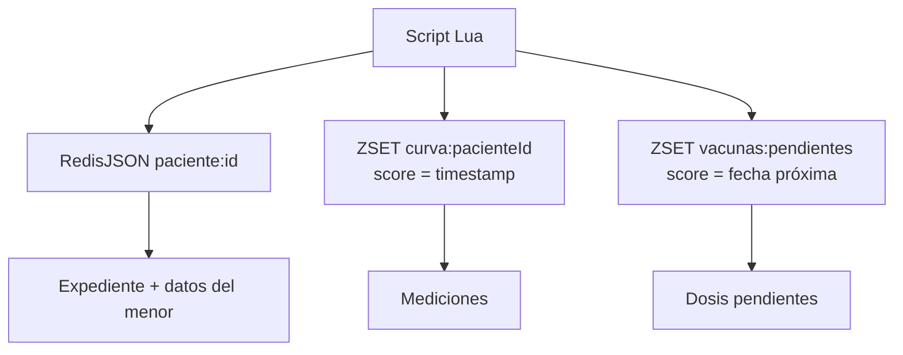

# Centro médico pediátrico — análisis de información (Redis)

El centro pediátrico comparte el núcleo del historial clínico, con dos extensiones propias del dominio: **curva de crecimiento** y **esquema de vacunación**. Las consultas son frecuentes, cortas y casi siempre por identificador de paciente conocido.

Motor asignado (decisión de proyecto): **Redis como sistema de registro** (no caché). El enunciado del curso menciona Firebase; este proyecto lo sustituye por Redis — pendiente de autorización del catedrático. Si se rechaza, Firebase vuelve y Redis queda solo como caché (cambio de un adaptador).

## Por qué Redis (y no un SQL más)

| Necesidad del dominio | Encaje |
|---|---|
| Acceso siempre por clave conocida (`paciente:{id}`) | RedisJSON / hash |
| Mediciones ordenadas en el tiempo | Sorted set (score = timestamp) |
| Vacunas pendientes / vencidas “hoy” | Sorted set (score = fecha próxima dosis) |
| Escrituras atómicas read-modify-write | Script Lua |

**Limitación consciente:** consultas ad-hoc del tipo “todos los niños con percentil de peso &lt; 3” no son naturales sin índice auxiliar o RediSearch. Se documenta; no se finge que Redis sea un warehouse analítico.

## Persistencia (trade-off obligatorio)

Redis de registro usa AOF (`appendfsync everysec`) + RDB. Ante un crash se puede perder **hasta ~1 segundo** de escrituras. Eso es aceptable para un historial de control pediátrico ambulatorio en este alcance académico, y debe quedar explícito.

La **caché** transversal de la plataforma vive en **otra instancia** Redis (sin AOF), para no persistir datos volátiles.

## Modelo conceptual

## Vista de almacenamiento (anticipación Entrega II)

Esto **no** es el entregable relacional; es el mapa mental de cómo el análisis se materializará después.

## Entidades y atributos

### Paciente (menor)

| Atributo | Tipo lógico | Clasificación | Notas |
|---|---|---|---|
| id | identificador | — | |
| nombres, apellidos | texto | **restringido** | menor de edad |
| fecha_nacimiento | fecha | restringido | define edad / percentil |
| sexo | enum | restringido | |
| dpi_menor | texto nullable | restringido | a menudo ausente |
| tutor_nombre | texto | confidencial | responsable |
| tutor_telefono | texto | confidencial | |
| tutor_dpi | texto | confidencial | |
| alergias_conocidas | texto | restringido | |
| creado_en | timestamp | — | |

### Expediente

Igual que el núcleo: `estado` (activo/archivado), `motivo_archivo`, `version`. En pediatría archivar puede significar traslado a medicina de adultos u otra institución.

### MedicionCrecimiento

| Atributo | Tipo lógico | Clasificación | Notas |
|---|---|---|---|
| pacienteId | ref | — | |
| fecha | timestamp | restringido | score del ZSET |
| peso_kg | número | restringido | |
| talla_cm | número | restringido | |
| perimetro_cefalico_cm | número nullable | restringido | sobre todo lactantes |
| percentil_peso | número nullable | restringido | |
| percentil_talla | número nullable | restringido | |
| registrado_por | ref usuario | confidencial | |

### TipoVacuna (catálogo)

| Atributo | Tipo lógico | Clasificación |
|---|---|---|
| codigo | texto | público |
| nombre | texto | público |
| dosis_totales_esquema | entero | público |
| intervalo_dias_tipico | entero | público |

### DosisVacuna

| Atributo | Tipo lógico | Clasificación | Notas |
|---|---|---|---|
| pacienteId | ref | — | |
| vacunaCodigo | texto | restringido | |
| numero_dosis | entero | restringido | 1..N del esquema |
| aplicada_en | fecha nullable | restringido | null = aún no aplicada |
| proxima_en | fecha | restringido | score en `vacunas:pendientes` |
| lote | texto nullable | confidencial | |
| aplicada_por | ref usuario | confidencial | |

### Consulta / Diagnóstico / Receta / Auditoría

Mismo significado del núcleo. Toda lectura de expediente pediátrico genera auditoría porque el sujeto es menor.

## Clasificación específica (crítico)

En pediatría el umbral sube: **casi todo el expediente es restringido** por tratarse de un menor, no solo diagnósticos o vacunas.

| Dato | Nivel |
|---|---|
| Nombre del centro, horarios, catálogo de vacunas | Público |
| Datos del tutor (teléfono, DPI) | Confidencial |
| Identidad del menor, mediciones, vacunas, consultas, alergias | **Restringido** |

## Operaciones propias de pediatría

1. Registrar paciente menor + tutor (nuevo ingreso).
2. Registrar medición de crecimiento (actualiza curva).
3. Registrar dosis de vacuna aplicada y programar próxima.
4. Listar vacunas pendientes / vencidas a una fecha (consulta por rango de score).
5. Consultar curva de crecimiento de un paciente.
6. Abrir expediente (siempre con auditoría).
7. Archivar expediente (traslado / egreso).

## Atomicidad

Cualquier operación que toque expediente JSON + ZSET de curva/vacunas debe ser atómica (script Lua en Entrega II). Sin eso hay riesgo de curva desfasada respecto al documento.
