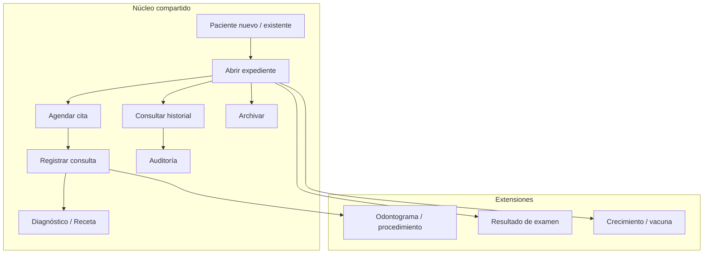

# Operaciones de la aplicación (lenguaje sencillo)

Lista de lo que la aplicación necesita hacer sobre los datos. **Sin SQL, sin endpoints, sin drivers.** Es el contrato de comportamiento que Entrega II implementará en los cuatro motores.

## Núcleo (las cuatro instituciones)

1. **Registrar paciente de nuevo ingreso** — alta de persona y apertura de expediente activo.
2. **Buscar paciente ya registrado** — por nombre, DPI, código de referencia o identificador interno.
3. **Abrir el expediente** de un paciente.
4. **Agendar una cita** — sin solapar con otra del mismo médico en el mismo intervalo.
5. **Registrar una consulta ocurrida** — opcionalmente ligada a una cita previa.
6. **Agregar un diagnóstico** a una consulta (catálogo y/o texto libre).
7. **Recetar un medicamento** (catálogo y/o texto libre, con dosis y frecuencia).
8. **Consultar el historial** — consultas, diagnósticos, recetas y extensiones de la institución.
9. **Archivar un expediente** — traslado, fallecimiento u otra baja; no borrar.
10. **Registrar acceso a información restringida** — auditoría quién / qué / cuándo.

## Extensión odontología

11. **Actualizar estado de una pieza dental** (código FDI).
12. **Registrar procedimiento dental** ligado a pieza y consulta.
13. **Consultar odontograma** completo del expediente.

## Extensión laboratorio

14. **Registrar resultado de examen** con estructura según tipo (hematología, orina, cultivo, …).
15. **Validar o anular** un resultado.
16. **Listar exámenes de un paciente** ordenados por fecha.
17. **Abrir un resultado concreto** (con auditoría).

## Extensión pediatría

18. **Registrar paciente menor + datos del tutor**.
19. **Registrar medición de crecimiento** (actualiza la curva).
20. **Registrar dosis de vacuna** y programar próxima.
21. **Listar vacunas pendientes o vencidas** a una fecha.
22. **Consultar curva de crecimiento** del paciente.
23. **Abrir expediente pediátrico** (siempre auditable por ser menor).

Estas operaciones son idénticas en intención para los cuatro motores; solo cambia *cómo* se persisten.
