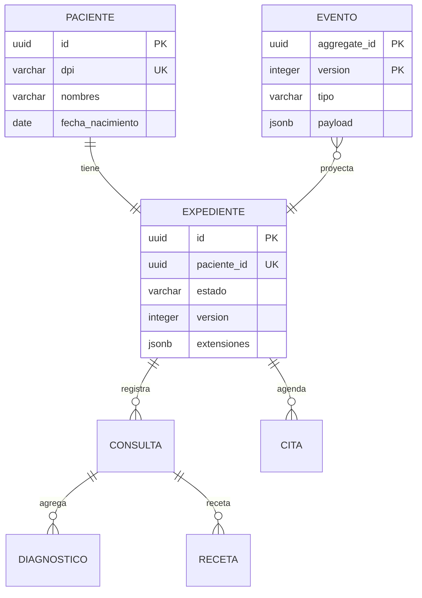
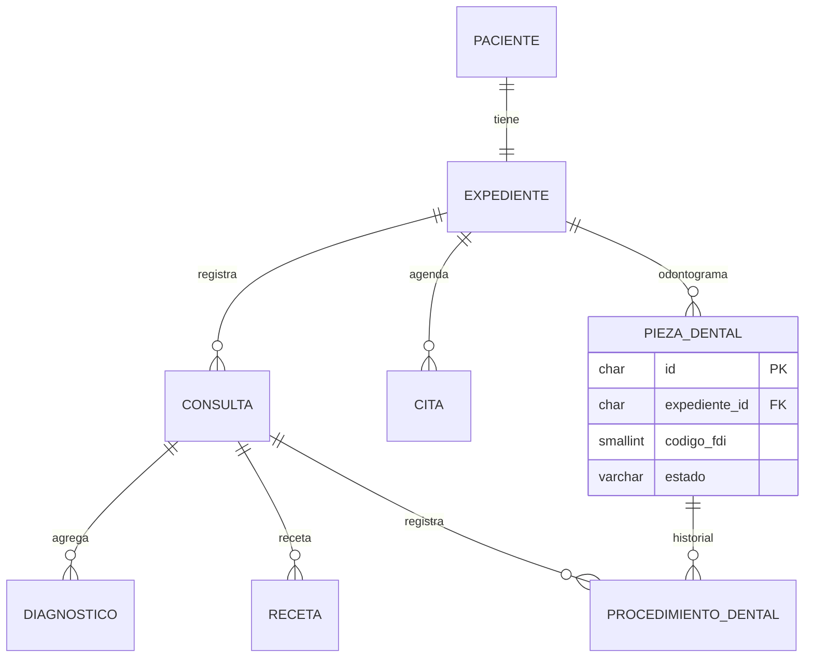
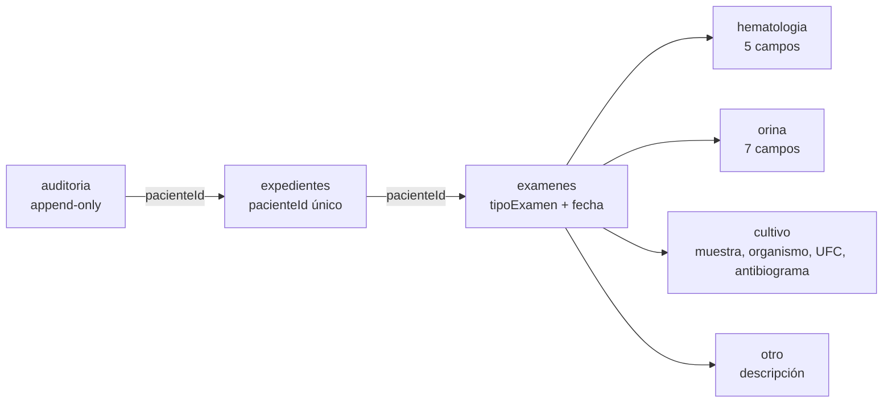
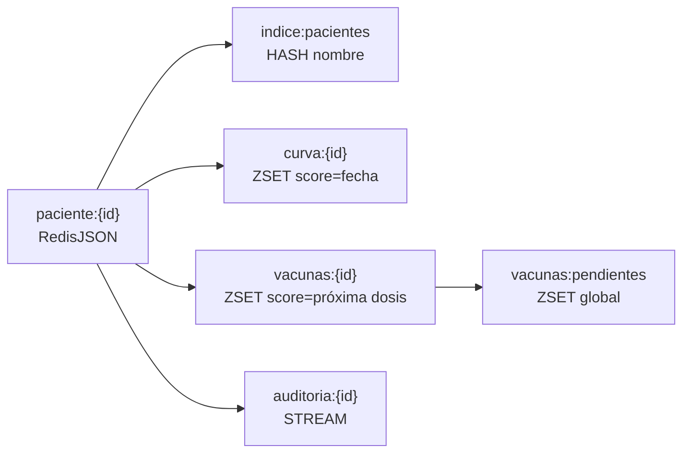

# Modelado por motor

## Hospital general — PostgreSQL

Event store append-only y read model normalizado en el esquema `clinico`. El agregado
`Expediente` se reconstruye desde `clinico.eventos`; el read model se escribe en la misma
transacción (decisión A de la fase 5).

- `UNIQUE(aggregate_id, version)` es la concurrencia optimista.
- `citas_sin_solape` usa `EXCLUDE USING gist (medico_id WITH =, tstzrange(inicio, fin) WITH &&)`.
- El expediente se enmienda con eventos; nunca se hace `UPDATE` destructivo del historial.

## Clínica odontológica — MySQL

CRUD directo en InnoDB. El odontograma es una tabla por pieza FDI y un historial de
procedimientos; la reserva de cita bloquea al médico con `SELECT ... FOR UPDATE`.

- `chk_pieza_fdi` valida cuadrante 1–4 y posición 1–8 (no el rango ingenuo 11–48).
- `auditoria_acceso` es append-only por privilegios: el usuario de app no tiene `UPDATE`
  ni `DELETE` sobre ella.

## Laboratorio clínico — MongoDB

El expediente es un documento; los exámenes van en una colección aparte y se referencian
por `pacienteId`. Un paciente acumula cientos de exámenes y casi nunca se leen todos
juntos; embeberlos choca con el límite de 16 MB de BSON.

- `$jsonSchema` con `oneOf` por tipo y `validationLevel: moderate`.
- Índice mínimo `{ pacienteId: 1, fecha: -1 }`.
- Antibiograma embebido como arreglo de `{ antibiotico, sensibilidad: S|I|R }`.

## Centro pediátrico — Redis

Redis es el sistema de registro, no una caché. Persistencia AOF `appendfsync everysec` +
RDB; la caché transversal vive en otra instancia (DB lógica separada por proceso).

- Lectura y escritura por clave conocida: `paciente:{id}`.
- `ZRANGEBYSCORE vacunas:pendientes -inf hoy` devuelve las dosis vencidas en una operación.
- El script Lua hace atómico el read-modify-write del JSON y los ZSET.
- Limitación: no hay consultas ad-hoc nativas (ver `08-limitaciones.md`).
